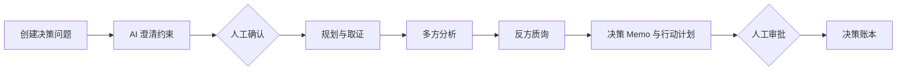

# 证策 VeriPlan

> A traceable AI decision workflow with evidence, counterarguments, and human approval.

VeriPlan 是面向小型出海团队的可追溯经营决策工作台。当前版本聚焦一个具体问题：**是否应该小范围试点 AI 售后客服？** 它不会直接替你拍板，而是把约束澄清、证据整理、多方分析、反方质询、行动计划和人工审批串成一条可回看、可中断、可恢复的决策链。

## 当前状态

**可直接运行：** 确定性的本地 Demo，包含 FastAPI、SQLite、React 单页工作台、两个独立人工闸门，以及从创建问题到审批入账的完整闭环。

**已完成离线联合验收：** DeepSeek Responses 模型适配器与 Tavily Search 适配器已经接入同一个可恢复工作流，并通过 MockTransport/Fake provider 的端到端测试。Planner 最多披露并执行 3 个去重查询，后续仍保留五个模型阶段和两个人工闸门。

**核心可信度边界已收紧：** 历史任务与当前应用模式不一致时只能查看；来源陈述必须引用现存证据，并明确标记为待人工核验；系统研究缺口不能被最终 Memo 删除。当前仅支持固定 14 天计划。

**业务基线与交付已补齐：** 创建决策时可填写 8 项内部业务基线，留空即未知；系统不会用行业均值补齐，缺失项会生成采集任务。输入齐全时展示可复算的用户输入试算，任务交付后可下载规范 Markdown，或使用浏览器打印/存为 PDF。

**默认仍锁定：** Live 写操作只有在 `APP_MODE=live`、`ENABLE_LIVE_WORKFLOW=true` 且两个 Key 都非空时才开放。本里程碑没有读取真实 API Key、没有发送真实 DeepSeek/Tavily 请求，也没有产生付费调用；离线通过不等于供应商真实链路已经验证，真实 smoke 仍需单独明确授权。

## 为什么做 VeriPlan

普通聊天式 AI 很容易把“看起来合理”包装成“值得执行”。VeriPlan 尝试把决策过程拆开，让每一步都能被检查：

- **先确认约束再研究**：预算、时间窗口和目标由用户核对，避免模型擅自补全关键条件。
- **来源陈述与推断分开**：来源陈述必须引用持久化证据编号，但引用只建立可回看关系，不代表系统已自动验证语义支持；推断不能伪装成来源事实。
- **强制反方视角**：在给出行动方案前，先列出反对意见与隐藏假设。
- **支持度不是成功率**：分数只衡量现有证据对建议的支持程度。
- **最后由人批准**：采纳、修改或暂缓只写入账本，不自动发消息、购买服务或执行外部业务动作。



## 核心能力

| 能力 | 当前实现 |
| --- | --- |
| 受控状态机 | 创建、运行、确认、失败重试、审批均受状态约束 |
| 可恢复执行 | SQLite 保存事件、阶段产物、证据、Memo 与审批记录 |
| 人工闸门 | 澄清确认与最终审批是两个独立节点 |
| 证据溯源 | 演示来源与联网来源逐条标识，事实引用证据 ID |
| 反方审查 | 输出反对意见、隐藏假设和仍需验证的缺口 |
| 安全适配器 | DeepSeek/Tavily 使用固定端点、结构化契约和脱敏错误 |
| 费用边界 | Tavily 固定 basic 搜索、每次最多 5 条结果，不请求答案、全文或图片 |
| 联合编排 | 最多 3 个搜索查询和 5 个模型阶段；逐查询持久化、失败降级和显式恢复 |
| 业务基线 | 8 项可选输入随决策冻结；未知项转为采集任务，不猜测代填 |
| 决策交付 | 后端规范 Markdown、浏览器打印/存为 PDF，均保留证据与人工边界 |

## 本地启动

需要 Python 3.12+ 和兼容 Vite 8 的 Node.js。

后端：

```bash
cd backend
python3 -m venv .venv
source .venv/bin/activate
python -m pip install -e '.[dev]'
APP_MODE=demo python -m uvicorn app.main:app --host 127.0.0.1 --port 8788
```

另开终端启动前端：

```bash
cd frontend
npm ci
npm run dev
```

打开 [http://127.0.0.1:5173](http://127.0.0.1:5173)。Vite 会把 `/api` 请求转发到本机后端 `8788` 端口。

默认数据库为后端工作目录下的 `veriplan.db`，重启后仍保留决策记录。也可以通过 `DATABASE_URL=sqlite:////absolute/path/demo.db` 指定独立数据库。当前只支持单应用进程，不要让多个后端进程共享同一个 SQLite 文件。

## 两分钟体验

1. 点击“填入 AI 售后客服示例”，展开“业务基线”检查合成数字、14 天窗口、8,000 元预算与目标，然后创建决策。
2. 在“待确认条件”页面核对模型整理的约束，点击“确认条件并继续研究”。
3. 查看冻结基线、确定性收益试算、证据卡、多方分析、反方意见与 14 天行动计划。试算始终标注为用户输入，不能当成已验证收益。
4. 下载 Markdown 或使用浏览器打印/存为 PDF，再填写审批备注，选择采纳、记录修改意见或暂缓；刷新页面后可从左侧账本重新打开。

Demo 证据和示例业务基线全部是合成材料，来源使用 `demo.invalid` 占位。空基线会按未知保存并给出内部采集任务；只有月工单量、重复率、处理时长、时薪、预计 AI 独立解决率、复核时长和工具成本均已知时才计算试算，可接受误答率单独作为风险门槛。输入会影响问题、预算、目标、研究查询和行动计划，但分析内容仍围绕 AI 售后客服场景，不是任意经营问题生成器。时间窗口固定为 14 天，其他窗口会在创建时被拒绝。

## 配置

应用只读取**进程环境变量**，不会自动加载仓库根目录的 `.env`。可复制 [.env.example](.env.example) 作为配置参考，但不要提交真实密钥。

| 环境变量 | 默认值 | 说明 |
| --- | --- | --- |
| `APP_MODE` | `demo` | `live` 仍需显式开关与两个 Key 才开放写操作 |
| `ENABLE_LIVE_WORKFLOW` | `false` | Live 写操作总开关；离线验收不会自动开启 |
| `DATABASE_URL` | `sqlite:///veriplan.db` | SQLite 数据库地址 |
| `DEEPSEEK_API_KEY` | 空 | Live 三重门之一；不要写入仓库、日志或命令历史 |
| `DEEPSEEK_MODEL` | `deepseek-v4-flash` | DeepSeek Responses 模型 |
| `DEEPSEEK_TIMEOUT_SECONDS` | `30` | 模型请求超时，范围 1–120 秒 |
| `DEEPSEEK_MAX_OUTPUT_TOKENS` | `4096` | 模型输出上限，范围 512–8192 |
| `TAVILY_API_KEY` | 空 | Live 三重门之一；不要写入仓库、日志或命令历史 |
| `TAVILY_TIMEOUT_SECONDS` | `15` | 搜索超时，范围 1–30 秒 |
| `TAVILY_TRUSTED_DOMAINS` | 空 | 逗号分隔，仅影响来源可靠度分级 |
| `TAVILY_BLOCKED_DOMAINS` | 空 | 逗号分隔，额外拒绝的来源域名 |

Tavily 请求固定访问 `https://api.tavily.com/search`，采用 `basic` 深度、最多 5 条结果、每来源最多 2 个片段，并关闭生成答案、原始全文、图片和自动参数。单个决策最多执行 3 个去重查询。部分查询失败但仍有安全证据时，工作流会带缺口继续并把支持度封顶 59；Live 零安全证据时停在 `researching`。任务整体进入 `failed` 时，显式重试会复用已成功查询并只补失败查询；已经生成报告的部分失败不会原地补查，前端提供“复制条件重新研究”，新任务不会继承旧证据、分析、Memo 或审批。返回的摘要属于**第三方来源信息**，不是经过 VeriPlan 独立核验的事实。

## 测试

后端：

```bash
backend/.venv/bin/python -m pytest backend/tests -q
backend/.venv/bin/python -m pip check
```

前端：

```bash
cd frontend
npm test -- --run
npm run build
```

适配器测试使用 `httpx2.MockTransport`，联合流程使用注入的 Fake providers，覆盖固定端点、请求形状、结构化响应、URL 安全、来源去重、提示注入隔离、逐次调用账本、错误脱敏、部分失败与恢复边界。测试不会使用真实 DeepSeek/Tavily 凭据。

## 离线参赛验收与干净快照

先生成一份机器可读的离线 Demo 证明。脚本会强制 Demo 模式、清除当前子进程中的供应商 Key、阻断 socket 联网，并在临时数据库中走完两个独立人工节点：

```bash
backend/.venv/bin/python scripts/verify_demo.py \
  --output artifacts/demo-verification.json
```

再从白名单构建经过秘密扫描的发布目录和确定性 ZIP。构建器要求 `.gitignore`、`.env.example`、`README.md`、`backend/`、`frontend/` 与 `scripts/` 没有未提交改动；`AGENTS.md`、`mmr.md`、内部文档和本地 Git 历史不会进入快照：

```bash
backend/.venv/bin/python scripts/build_submission_snapshot.py \
  --output artifacts/VeriPlan \
  --archive artifacts/VeriPlan.zip
```

快照内的 `SUBMISSION_MANIFEST.json` 记录源提交、逐文件大小与 SHA-256。相同提交的两次构建应产生相同 ZIP 哈希。`artifacts/` 已忽略且只用于本地交付；运行脚本不会上传平台、更新公开仓库或调用真实供应商。

## API

| 接口 | 行为 |
| --- | --- |
| `GET /api/health` | 返回模式、数据库以及模型/搜索能力状态，不返回密钥 |
| `POST /api/decisions` | 创建决策约束 |
| `GET /api/decisions` | 读取本地决策列表 |
| `GET /api/decisions/{id}` | 读取持久化快照 |
| `GET /api/decisions/{id}/export.md` | 下载已交付任务的 UTF-8 Markdown；未生成 Memo 时返回 409 |
| `POST /api/decisions/{id}/run` | 启动后台阶段，客户端随后轮询快照 |
| `POST /api/decisions/{id}/confirm` | 记录人工澄清确认 |
| `POST /api/decisions/{id}/retry` | 仅从任务整体 `failed` 的阶段重试，保留此前完成的阶段输出 |
| `POST /api/decisions/{id}/review` | 记录 `accepted`、`revised` 或 `deferred` 审批 |

找不到记录返回 404，非法状态或重复启动返回 409，字段校验失败返回 422。进程异常重启后，未完成的运行会标记为可重试失败，不会越过人工确认或审批节点。

## 目录结构

```text
backend/
  app/
    providers/      # Demo、DeepSeek、Tavily、契约与安全策略
    main.py         # FastAPI 应用、健康状态与决策 API
    workflow.py     # 状态机编排、重试、溯源和阶段持久化
    repository.py   # SQLite 数据访问、冻结基线与兼容迁移
    baseline.py     # 确定性试算与内部采集任务
    markdown_export.py # 规范 Markdown 报告渲染
  tests/            # API、工作流、适配器和安全边界测试
frontend/
  src/
    components/     # 表单、时间线、证据、Memo 与账本
    App.tsx          # 页面状态、轮询和请求竞争保护
scripts/
  verify_demo.py     # 阻断联网的完整 Demo 证据器
  build_submission_snapshot.py # 白名单、秘密扫描与确定性 ZIP
```

## 安全边界

- 密钥只从环境变量读取，由 `SecretStr` 持有，不写入数据库、健康响应或错误信息。
- DeepSeek 与 Tavily 的生产主机固定，普通配置不能把密钥转发到任意地址。
- 搜索结果只接受公开 HTTPS URL；拒绝凭据 URL、IP literal、本地主机和私有/保留网络语义地址。
- 第三方证据文本始终按不可信数据处理，不允许其中的指令改变系统角色、工具或输出格式。
- 当前不执行任何外部业务动作，也不承诺多进程、团队权限、生产部署或完整比赛交付。
- 任务模式与当前应用模式不一致时，运行、重试、确认和审批都会在 provider 调用前拒绝；前端仅允许查看、导出，并复制创建输入与冻结基线到当前模式的新任务。

## 路线图

- [x] 本地 Demo 闭环与浏览器验收
- [x] DeepSeek 结构化模型适配器（离线 MockTransport 验收）
- [x] Tavily 安全搜索适配器（离线 MockTransport 验收）
- [x] DeepSeek + Tavily 联合编排（完全离线验收）
- [x] 核心可信度修复（模式隔离、引用结构、缺口保全、查询契约与固定 14 天边界）
- [x] AI 售后业务基线、确定性试算、采集任务与 Markdown/打印导出
- [x] 本地参赛证据器、干净发布快照与初赛演示材料
- [ ] 重新核对官方文档并执行一次显式授权的真实 smoke test
- [ ] 团队策略卡、结果回填和效果评估
- [ ] 部署、权限、公开仓库同步与比赛平台正式提交

## License

本仓库当前未附带开源许可证。代码公开可见不代表自动授予复制、修改或分发权；如需复用，请先联系仓库所有者。
